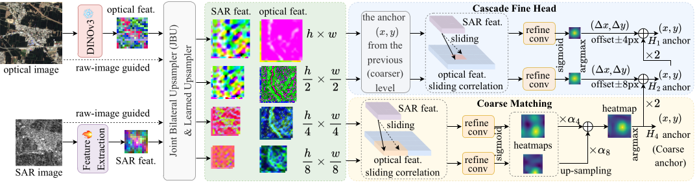
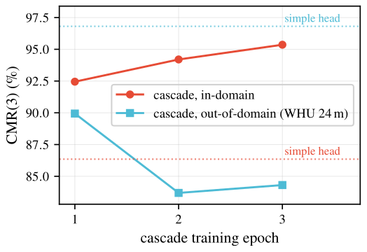
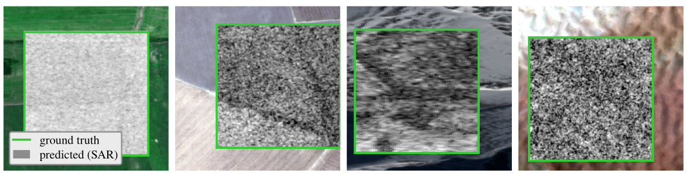

# Template-Matching-DINOv3 (DOSR-Net)


**DOSR-Net** is a cross-modal **SAR ↔ optical template-matching** framework for
remote-sensing image registration (TGRS 2026). It localizes a small SAR template
inside a larger optical reference patch by pairing a **frozen DINOv3 ViT-L/16**
optical backbone (satellite-pretrained) with a **jointly-trained SAR CNN encoder**,
upsampling both feature maps with **FeatUp / JBU** image-guided upsamplers, and
matching them through a **coarse-to-fine cascade** of normalized cross-correlations.
The whole model family is YAML-driven and trained with
[JackFramework](https://github.com/Archaic-Atom/JackFramework), which owns the
training loop, DDP launcher, logging and checkpoint I/O.

<p align="center"></p>

> **Paper (IEEE TGRS 2026):** *Rethinking SAR–Optical Pre-Alignment with
> Foundation Models for Template Matching.* The matcher constructs a usable
> cross-modal score while the raw feature spaces remain separated.
> At the main budget, five seeds give close final means for pre-aligned and
> random initialization under full SAR encoder fine-tuning. Pre-alignment helps
> frozen encoders and some partial-freezing or small-data settings.
> The direct-trained cascade reaches CMR(1/3) of 93.30/95.83 on the full SEN1-2 test.

The model family includes `TM_Model_A..G`, `TM_Model_CB` and `TM_Model_CW`.
`TM_Model_C` is the direct-trained cascade. The other variants test initialization,
encoder trainability, the optical provider and coarse upsampling.

> For the authoritative, deep developer guide (entry-point chain, config-vs-CLI
> precedence, dataloader contracts, the cascade head internals, and a list of known
> pitfalls) see **[`CODE_STRUCTURE.md`](CODE_STRUCTURE.md)**. This README is a
> code-usage overview and links into that document rather than duplicating it.

---

## Key features

- **256/192 geometry.** Optical reference patch **256×256**, SAR template **192×192**;
  the ground-truth label `(x, y)` is the **top-left corner** of the SAR template
  inside the optical patch, so displacement lives in `[0, 64]`. (Migrated from the
  earlier 128/64 geometry to match the ME-SSM evaluation protocol.)
- **Frozen DINOv3 ViT-L/16 optical backbone** (`dinov3_vitl16`, satellite-pretrained
  `sat493m` weights, 1024-d stride-16 features) paired with a **jointly-trained
  `SarResNet16GN`** SAR encoder (ResNet-style, GroupNorm, no BatchNorm).
- **FeatUp / JBU upsampling.** Image-guided `JBULearnedRange` upsamplers
  (`featup.upsamplers`) lift stride-16 features to stride-4/8 for matching; trained
  end-to-end (FeatUp's pretrained DINOv2 weights are **not** reused).
- **Coarse-to-fine cascade matching.** Normalized cross-correlation (SAR template =
  conv kernel, optical search region = input) at coarse stride-4 + stride-8, then a
  windowed stride-2 and stride-1 refinement around the detached coarse argmax.
- **JackFramework + WebDataset training.** Iterable WebDataset shard pipeline for the
  ~13.2M-sample training set, with custom DDP-balanced shard splitting, large sample
  shuffle buffers, and a map-style backend for evaluation.
- **`TM_Model_A..G`, `CB` and `CW` ablation family** isolating Stage-1 pre-alignment-as-init, cascade
  vs standard-fine, sub-pixel decode, and a learned-inner-product (VICReg) probe.
- **Cross-dataset zero-shot evaluation** adapters for **WHU-OPT-SAR** (cross-sensor)
  and **QXS-SAROPT** (cross-resolution), plus a controlled GSD-sweep harness.
- **Analysis / probe tooling** (`Source/Tools/`, `Source/Tools/probes/`) that produces
  the mechanistic numbers in the paper (where similarity lives, control batteries,
  readout-specific recovery curves, CKA and localization controls).

---

## Repository structure

```
Template-Matching-DINOv3/
├── CODE_STRUCTURE.md              # authoritative developer guide (read this)
├── Source/
│   ├── main.py                    # the ONLY entry point (python Source/main.py ...)
│   ├── Libs/dinov3/               # DINOv3 git submodule (frozen optical backbone)
│   ├── UserModelImplementation/
│   │   ├── user_interface.py      # CLI surface + dataset/model zoo dispatch
│   │   ├── user_define.py         # ROOT_PATH / DINOv3 repo + weights path constants
│   │   ├── Models/
│   │   │   ├── __init__.py        # model_zoo: A..G, CB, CW → interface classes
│   │   │   ├── builder.py         # YAML → ComposedTM assembly
│   │   │   ├── _interface_base.py # generic JackFramework model handler
│   │   │   ├── TM_Model_{A..G,CB,CW}/   # per-variant config.yaml (+ thin __init__.py)
│   │   │   ├── _components/        # backbones, JBU, matching heads, losses, decode
│   │   │   └── _legacy/legacy_A/   # A's original hand-written code (reference only)
│   │   └── Dataloaders/            # TMDataloader (map-style + WebDataset backends)
│   └── Tools/                      # eval/metric/probe scripts (+ probes/)
├── Scripts/
│   ├── common.sh                   # shared config + helpers (sourced by all launchers)
│   ├── reproduce/                  # ① evaluate the RELEASED models (no training)
│   ├── train/                      # ② train your own, then evaluate
│   ├── legacy/                     # the original per-experiment launchers (server paths)
│   └── legacy_128_64/              # superseded 128/64-geometry launchers
├── Datasets/                       # CSV manifest example; image data are downloaded separately
├── Weights/                        # DINOv3 checkpoint (gitignored, download separately)
├── assets/                         # README figures (pipeline, qualitative, ...)
├── MODELS.md                       # pretrained-model manifest (download + placement)
├── README.md / README_zh.md
└── LICENSE
```

See **[`CODE_STRUCTURE.md` §1](CODE_STRUCTURE.md)** for the full, current tree and the
"JackFramework lives outside this repo" mental model.

---

## Model variants

The variants share frozen DINOv3 ViT-L/16 optical features, a `SarResNet16GN`
SAR encoder, and **256/192 geometry** (`matching_dim = 256`, `sar_size = 192`). Each `TM_Model_X/` is a
thin `ComponentBasedInterface` subclass that only sets `CONFIG_PATH`; all behavior is
in its `config.yaml`. Variants control Stage-1 initialization, encoder freezing,
matching and upsampling, and the optical provider.

| Variant | Matching head | Stage-1 (`load_pretrained_sar`) | Stage-2 SAR (`freeze_sar_encoder`) | Stage-2 loss | Decode | What it isolates |
|---|---|---|---|---|---|---|
| **A** | `StandardMatchingHeadJBU` | `true` (warm-start from Stage-1 aligned ckpt) | `false` (keeps training) | `two_stage_matching_loss` | hard argmax | Stage-1 pre-alignment **as initialization** (only diff vs B) |
| **B** | `StandardMatchingHeadJBU` | `false` (random SAR init) | `false` | `two_stage_matching_loss` | hard argmax | No-Stage-1 control / baseline for A |
| **C** | `CascadeHeadJBU` | `false` (direct-trained, no Stage-1) | `false` (joint) | `cascade_loss` | hard argmax | **The proposed method** — direct-trained cascade |
| **D** | `StandardMatchingHeadJBU` | `true` | `true` (frozen) | `two_stage_matching_loss` | `soft_subpixel` | Sub-pixel decode on A's head (reuses A's ckpt; eval-only) |
| **E** | `CascadeHeadJBU` | `true` * | `true` * | `cascade_loss` | `soft_subpixel` | Cascade + sub-pixel; **evaluated on C's checkpoint** |
| **F** | `StandardMatchingHeadJBU` (+ `AlignmentIPHead` in Stage-1) | `true` | `true` (frozen) | `two_stage_matching_loss` | hard argmax | Learned-inner-product Stage-1 (W_s/W_d + VICReg rank floor), frozen-encoder Stage-2 |
| **G** | `StandardMatchingHeadJBU` | shared Stage-1 checkpoint or random | `false` | `two_stage_matching_loss` | hard argmax | Trainable row of the shared-initialization four-arm test |
| **CB** | `CascadeHeadBilinear` | `false` | `false` | `cascade_loss` | hard argmax | Replace only coarse stride-16-to-4/8 JBU lifts with bilinear interpolation |
| **CW** | `CascadeHeadJBU` | `false` | `false` | `cascade_loss` | hard argmax | Use the web-pretrained LVD-1689M optical provider |

**Checkpoint-reuse:** D reuses A's checkpoint and E reuses C's checkpoint — both add
only an eval-time `argmax_type` (sub-pixel) change, with `matching.args` kept
byte-identical so the state_dicts match. Only `matching.args` is byte-identical, not
the whole config: like E, D's own training block differs from the model it borrows from
(D sets `freeze_sar_encoder: true` vs A's `false`), so D is meant to be *evaluated on*
A's checkpoint, not trained from its own config. Sub-pixel exists in code
(`_components/sub_pixel.py`) but is **not** a headline contribution of the paper.

> \* **TODO / caveat:** E's architecture and state_dict are byte-compatible with C, and
> E is intended to be *evaluated on C's checkpoint* with sub-pixel decode. However, E's
> own `config.yaml` training block (`load_pretrained_sar: true`, `freeze_sar_encoder:
> true`, non-zero warmups) is **stale** relative to C's direct-training pivot and does
> not reproduce C if launched as written. Treat E as "C's architecture + sub-pixel
> decode, evaluated on C's checkpoint"; confirm intent before training E from its own
> config.

The revised four-arm test uses F for frozen encoders and G for trainable
encoders. Both pre-aligned arms use the same Stage-1 checkpoint. C versus CB
keeps the fine learned upsamplers and raw-image stems unchanged.
The original A/B/F results remain the submitted single-run comparison.

---

## Results

All numbers follow **ME-SSM's evaluation protocol** on SEN1-2 (optical reference
256×256, SAR template 192×192): per-template **CMR@k px** (correct-match rate — one
`(x, y)` per template, dense zero-reject).
We use the same geometry and CMR metrics with an independent SEN1-2 draw.
The headline compares complete pipelines; the four-arm experiment holds the
matching architecture and training data fixed.

### In-domain SOTA (SEN1-2, full test set)

The proposed direct-trained cascade (`TM_Model_C`) beats prior work at **both**
thresholds. Full test set = all 7,740 pairs × 289 offsets (≈2.24M positions).

| Method | Venue | CMR(1) ↑ | CMR(3) ↑ | CMR(5) ↑ |
|---|---|---|---|---|
| ME-SSM (protocol source) | TGRS 2026 | 62.14 | 89.19 | 93.04 |
| VU-Net | ICSIDP 2024 | 63.0 | 87.0 | 90.0 |
| RMSO-ConvNeXt | — | — | 94.36 | — |
| **Ours (cascade C, direct-trained)** | — | **93.30** | **95.83** | **96.30** |

Mean error 1.13 px, median 0 px. `Checkpoint_C_phase2_8gpu/model_epoch_2.pth`.

### Shared-initialization comparison (Table IV, 20k)

Values are mean ± sample SD across seeds 2024–2028 after five matching epochs.
Both S1 arms start from the same symmetric learned-inner-product Stage-1 checkpoint.

| Arm | CMR(1) ↑ | CMR(3) ↑ | MEE (px) ↓ |
|---|---|---|---|
| S1/Tr | 67.86 ± 0.75 | 86.15 ± 0.21 | 3.672 ± 0.052 |
| R/Tr | 67.84 ± 0.91 | 86.14 ± 0.21 | 3.608 ± 0.058 |
| S1/Fr | 67.48 ± 0.26 | 86.16 ± 0.22 | 3.666 ± 0.035 |
| R/Fr | 67.49 ± 1.22 | 85.04 ± 0.29 | 4.069 ± 0.061 |

At the main budget, fully fine-tuned arms have close mean accuracy.
Pre-alignment improves the frozen arm at 3 px and lowers mean error.
Supplementary tests show gains with partial freezing and at 500/1,000 source pairs.
The original single-run comparison is kept separately in [MODELS.md](MODELS.md).

### Representation diagnostics

The probes test raw cosine localization, paired-content dependence, representation
change and recovery under feature restriction. Recovery curves describe each fixed
readout rather than a strict capacity gap. The initialization experiment directly
tests whether a separate pre-alignment stage improves final matching.
See [`Source/Tools/probes/`](Source/Tools/probes/) and `probe_common_level.py`.

### Cross-dataset zero-shot (cascade, no retraining)

The specialized cascade transfers strongly on its confident half but degrades on the
coarse tail; OOD robustness *decreases* with training specialization (see
[`CODE_STRUCTURE.md`](CODE_STRUCTURE.md) and the paper's Discussion).

| Dataset | shift | CMR(3) | high-conf CMR(3) | gross-fail % |
|---|---|---|---|---|
| WHU-OPT-SAR | cross-sensor (10 m) | 74.39 | 96.12 | 4.64 |
| QXS-SAROPT | sensor and resolution (1 m) | 10.40 | 10.80 | 31.35 |

<p align="center"></p>

### Qualitative (SEN1-2 in-domain)

SAR template (grey) pasted at the **predicted** location; green box = ground truth.

<p align="center"></p>

---

## Pretrained models

The download address is unchanged. The `Weights` folder contains the original
11 weight files and 66 revision checkpoint files under `Revision_20261107/`.
[MODELS.md](MODELS.md) gives placement instructions.
[MODELS_REVISION.md](MODELS_REVISION.md) and the
[per-file index](docs/checkpoints_revision.csv) map the added weights to the
current paper tables, figures, seeds and epochs.

> **Download — Baidu netdisk / 百度网盘:**
> <https://pan.baidu.com/s/1lhXTqkXKwzg5H9PVtt01EQ?pwd=ug7r> — extraction code: `ug7r`

The shared `Weights` folder contains everything:

| file / dir | size | contents |
|---|---|---|
| `dinov3_vitl16_pretrain_sat493m-eadcf0ff.pth` | 1.2 GB | frozen DINOv3 ViT-L/16 optical backbone (public Meta weights) |
| `Checkpoint_C_phase2_8gpu/` | 237 MB | **proposed cascade `TM_Model_C`** (headline) |
| `Checkpoint_A_ft_256/`, `Checkpoint_B_256/` | 178 MB ea. | S1/Tr (A-ft), R/Tr (B) trainable arms |
| `Checkpoint_F_s2_frozen_256/`, `Checkpoint_RF_s2_frozen_256/` | 102 MB ea. | S1/Fr, R/Fr frozen arms |
| `Checkpoint_A_stage1_256/`, `Checkpoint_F_stage1_256/` | 76 / 80 MB | Stage-1 aligned (A) and learned-IP (F) encoders |
| `Revision_20261107/` | 66 checkpoint files | Shared-initialization runs, early epochs, reduced budgets, partial freezing, few-pair and upsampling controls |

**Placement:** put the backbone at `Weights/dinov3_vitl16_pretrain_sat493m-eadcf0ff.pth`
(the path every `config.yaml` resolves as `${root_path}/Weights/...`), and the
`Checkpoint_*/` directories at the **project root** next to `Source/`:

```bash
bash Scripts/reproduce/eval_cascade.sh Checkpoint_C_phase2_8gpu/model_epoch_2.pth 0
```

### Which checkpoint goes with which launcher

`by name` = the script opens that directory by its hard-coded name, so it **must** sit at
the project root under exactly that name. `by arg` = you pass the checkpoint path in, so
it can live anywhere.

| checkpoint (at project root) | trained by | evaluated by | lookup |
|---|---|---|---|
| `Checkpoint_C_phase2_8gpu/model_epoch_2.pth`<br>**proposed cascade** | `run_train_C_direct.sh sub40` → `full_resume` (writes `Checkpoint_C_direct_{sub40,full}_256/`) | `run_eval_C_2k.sh <ckpt> <tag> [gpu]`<br>sub-pixel variant: `run_eval_E_2k.sh <ckpt> <tag> [gpu]` | **by arg** |
| `Checkpoint_A_ft_256/model_epoch_4.pth`<br>S1/Tr (A-ft) | `run_a_ft_vs_b.sh` (writes here) | `run_eval_std_2k.sh TM_Model_A <ckpt> <tag>` | by name (train) |
| `Checkpoint_B_256/model_epoch_4.pth`<br>R/Tr (B) | `run_a_ft_vs_b.sh` (writes here) | `run_eval_std_2k.sh TM_Model_B <ckpt> <tag>`<br>also read **by name at epoch 4** by `run_eval_frozen_full.sh` | **by name** |
| `Checkpoint_F_s2_frozen_256/model_epoch_4.pth`<br>S1/Fr | `run_frozen_arms_F.sh` | `run_eval_frozen_full.sh [FEPOCH] [CSV] [N] [TAG]` — reads **by name** | **by name** |
| `Checkpoint_RF_s2_frozen_256/model_epoch_4.pth`<br>R/Fr | `run_frozen_arms_F.sh` | `run_eval_frozen_full.sh [FEPOCH] [CSV] [N] [TAG]` — reads **by name** | **by name** |
| `Checkpoint_A_stage1_256/model_epoch_5.pth`<br>Stage-1 aligned | `start_train_stage1_256_A.sh` | consumed as the Stage-1 warm-start by `run_a_ft_vs_b.sh` (`S1=` line) | **by name** |
| `Checkpoint_F_stage1_256/model_epoch_9.pth`<br>Stage-1 learned-IP | `start_train_stage1_256_F.sh` | consumed as the Stage-1 warm-start by `run_frozen_arms_F.sh` (`S1=` line) | **by name** |
| `Weights/dinov3_vitl16_pretrain_sat493m-eadcf0ff.pth`<br>frozen backbone | — (public Meta weights) | every variant, via `${root_path}/Weights/...` in each `config.yaml` | **by name** |

The portable `tm_eval` helper accepts checkpoint paths for every model.
Legacy launchers and the four-arm launcher use their listed directory names.
Keep those names when using those entry points, or pass an explicit checkpoint
to the shared helper.

> **The launchers are not portable as shipped** — see
> [Paths you must edit](#paths-you-must-edit) before running any of them.

---

## Quick start

`Scripts/` has two entry points. Both source `Scripts/common.sh`, which derives the
project root from its own location and reads every data path from the environment —
so a clone at any path runs without editing a script.

### ① Evaluate the released models — [`Scripts/reproduce/`](Scripts/reproduce/)

Inference only; nothing is trained and no checkpoint is modified.

```bash
export TM_EVAL_CSV=/path/to/image_test_2k_256.csv

bash Scripts/reproduce/eval_cascade.sh                  # Table I  — proposed cascade
bash Scripts/reproduce/eval_arms.sh 0                   # Table III — submitted single-run test
bash Scripts/reproduce/eval_cross_dataset.sh            # Table VII — zero-shot transfer
```

Verified on an RTX 4080 with the released cascade on the 2k eval set:
`PCK@1 93.20 / PCK@3 95.70 / PCK@5 96.05`, mean 1.10 px — matching the paper's 2k
figures for that checkpoint.

### ② Train your own — [`Scripts/train/`](Scripts/train/)

```bash
export TM_TRAIN_LIST=./Datasets/shard_train_256_full.csv

bash Scripts/train/train_cascade.sh smoke               # 1 GPU, real tracebacks — do this first
bash Scripts/train/train_cascade.sh phase1 4 10         # subset warm-start
bash Scripts/train/train_cascade.sh phase2 Checkpoint_C_direct_sub40_256/model_epoch_4.pth
```

The pre-alignment ablation (`train_stage1.sh`, `train_arms.sh`) is only needed to
reproduce the 2x2 causal test — the proposed method does not use Stage-1 at all.

> The original per-experiment launchers now live in
> [`Scripts/legacy/`](Scripts/legacy/); they hard-code our servers' paths and are kept
> for provenance only.

---

## Installation

Training dependencies are listed below. Use a Python 3.11 / PyTorch 2.x environment
with the CUDA build matching your system. The separate
`tests/requirements-cpu.txt` pins the dependencies for the lightweight CPU checks.

```bash
# 1. Clone with the DINOv3 submodule (frozen optical backbone).
git clone --recurse-submodules https://github.com/Archaic-Atom/Template-Matching-DINOv3.git
cd Template-Matching-DINOv3
# SSH-less? The submodule URL is git@github.com:facebookresearch/dinov3.git;
# rewrite it to https://github.com/facebookresearch/dinov3.git if you lack SSH keys.

# 2. Install JackFramework (not vendored here; owns the training loop / DDP / I/O).
git clone https://github.com/Archaic-Atom/JackFramework.git
cd JackFramework && ./install.sh && cd ..

# 3. Install FeatUp (REQUIRED — external dependency, not a submodule).
#    The JBU variants import
#    `featup.upsamplers.JBULearnedRange`. Install from facebookresearch/FeatUp.

# 4. Other Python deps (into the same env):
#    torch, torchvision, numpy, pandas, pyarrow, Pillow, webdataset
#    (webdataset is required for iterable training; pyarrow is required by
#    the CSV-based evaluation loader.)

# 5. Place the DINOv3 satellite-pretrained weights under Weights/ (gitignored):
#    Weights/dinov3_vitl16_pretrain_sat493m-eadcf0ff.pth   (DINOv3 ViT-L/16, ~1.2 GB)
#    Download: see "Pretrained models" above (Baidu netdisk share, code ug7r).
```

### Paths you must edit

Everything below is hard-coded to **our training servers**. Nothing auto-detects, so go
through this list once before running anything.

**1. Python-side constants** — `Source/UserModelImplementation/user_define.py`:

| constant | shipped value | change? |
|---|---|---|
| `ROOT_PATH` | `/data/raozhibo/Documents/Programs/Template-Matching-DINOv3/` | **Yes** — set to your clone, or pass `--root_path` at launch. It is substituted into every `config.yaml`'s `${root_path}` placeholder. |
| `WEIGHTS_PATH` | `Weights/dinov3_vitl16_pretrain_sat493m-eadcf0ff.pth` | No — relative to `ROOT_PATH`; keep the backbone there. |
| `DINOv3_PATH` | `Source/Libs/dinov3/` | No — relative, the git submodule. |
| `DINOv2_PATH`, `WEIGHTS_DINOV2_PATH` | `Source/Libs/dinov2/`, `Weights/depth_anything/model.pth` | Unused legacy — ignore. |

**2. Launcher-script headers** — the first lines of each script in `Scripts/`:

| variable | shipped value | in how many scripts |
|---|---|---|
| `PROJ` | `/data/raozhibo/Documents/Programs/Template-Matching-DINOv3` (most also `cd "$PROJ"`) | 29 of 41 |
| `PY` | `/data/raozhibo/anaconda3/envs/stereoA/bin/python` | 28 of 41 |

**3. Dataset / manifest paths** inside the launchers — these point at data that is *not*
in the repo (see [Data preparation](#data-preparation) to regenerate them):

| variable | shipped value | used for |
|---|---|---|
| `MANIFEST`, `CSV`, `EVAL_CSV` | `/data4/datasets/eval2k_opt256_sar192/image_test_2k_256.csv` | in-domain 2k eval (also `eval10k_…`, `eval20k_…` variants) |
| `CSV`, `EVAL_CSV` (relative form) | `Datasets/test_256_2k.csv` | same eval set, repo-relative variant |
| `CSV` | `/data5/datasets/cross_eval/whu_opt_sar/cross_eval.csv`<br>`/data5/datasets/cross_eval/qxs_saropt/cross_eval.csv` | cross-dataset zero-shot eval |
| `RAW` | `/data5/datasets/whu-opt-sar`, `/data5/datasets/QXSLAB_SAROPT` | raw source datasets for the adapters |
| `OUTBASE` | `/data5/datasets/cross_eval_resolution` | GSD-sweep output |
| `--trainListPath` | `./Datasets/shard_train_256_full.csv`, `/data5/datasets/TM_shards/shard-…` | WebDataset training shards |

> Note the `/data4` vs `/data5` split is an artifact of our data moving between machines —
> both appear, so grep for **both** when repointing.

A quick way to see every absolute path a script will use:

```bash
grep -nE "^(PROJ|PY|MANIFEST|CSV|EVAL_CSV|RAW|OUTBASE)=|/data[0-9]*/" Scripts/<script>.sh
```

**DDP caveat:** because the optical backbone (and, in some variants, the SAR encoder)
is frozen, JackFramework's DDP wrap needs `find_unused_parameters=True`. That patch
lives only on the training servers' JackFramework install — see
[`CODE_STRUCTURE.md §2.5`](CODE_STRUCTURE.md).

---

## Data preparation

### In-domain SEN1-2 (256/192) WebDataset shards

The production data generator is **`Scripts/make_opt256_sar192_shards.py`** (a
byte-identical copy lives at `Source/Tools/make_opt256_sar192_shards.py`). It crops and
packs co-registered 256×256 SEN1-2 (Sentinel-1 SAR `s1_*` + Sentinel-2 optical `s2_*`,
four seasons) directly into WebDataset `.tar` shards — no intermediate PNG dump:

- **Optical reference** = the original 256×256 `s2` PNG bytes, copied verbatim.
- **SAR template** = the `s1` image cropped to 192×192 at top-left `(cx, ry)` and
  re-encoded as PNG.
- Each sample = three tar entries sharing a key:
  `<key>.sar.png` (192×192 grayscale), `<key>.rgb.png` (256×256 RGB),
  `<key>.label.cls` (ASCII `"<cx> <ry>"` — top-left corner, **not** centered, **not**
  normalized).

Train/test are **disjoint at the scene/patch level** (per-season fixed-seed split, no
scene leakage). Offsets multiply the pairs: **TEST** uses a dense stride-4 grid
(`17×17 = 289` offsets per pair); **TRAIN** uses random offsets (default 48 per pair).

```bash
# Generate test split first (fast), then train split (nohup-friendly wrapper):
bash Scripts/legacy/run_gen_opt256_sar192.sh
# or directly:
python Scripts/make_opt256_sar192_shards.py --split test  --workers 16
python Scripts/make_opt256_sar192_shards.py --split train --workers 16
```

This writes `TM_shards_opt256_sar192_{train,test}/` plus a **shard-manifest CSV**
`shard_path.csv` with header `path,file_num` — the iterable backend reads this to learn
each shard's sample count (and uses `sum(file_num)` as the authoritative on-disk
total). With default settings the test set is ≈2.24M samples (7740 pairs × 289) and the
full train set is ≈13.18M samples; the exact train count depends on the SEN1-2 tree.

A small **map-style** evaluation CSV (`SAR_Image,RGB_Image,Label` with
`Label = "[cx, ry]"` JSON) is built by **`Scripts/make_2k_eval_256.py`** from the same
disjoint `test_pairs.txt`, defaulting to 2000 samples.

### Cross-dataset zero-shot adapters

**`Source/Tools/cross_dataset_adapter.py`** resamples external SAR-optical datasets to a
target GSD and emits SEN1-2-shaped 256/192 eval pairs (`SAR_SIZE=192`, `RGB_SIZE=256`;
note the module/class docstrings still say "64/128" — that text is stale, trust the
code):

| Adapter (`--dataset`) | Source | Native → target GSD | Role |
|---|---|---|---|
| `whu_opt_sar` | WHU-OPT-SAR (GF-1 + GF-3) | 5 m → 10 m (downsample) | cross-sensor |
| `qxs_saropt`  | QXS-SAROPT (GF-3 + Google Earth, native 256×256) | 1 m → 1 m (no resample) | cross-resolution |
| `sarptical`   | SARptical (TerraSAR-X + aerial) | 1 m → 10 m | cross-sensor (aux) |

```bash
bash Scripts/legacy/run_regen_cross_256.sh     # regen WHU + QXS at 256/192
```

Each run writes `sar/`, `rgb/`, a `manifest.pt` (for `Scripts/pack_to_webdataset.py`), a
`cross_eval.csv` (`SAR_Image,RGB_Image,Label` — same schema as the in-domain map-style
eval CSV, directly consumable by `--mode test`), and a `meta.json` provenance file. A
`--target_res_m` flag (downsample-only, guarded) drives a controlled GSD sweep
(`Scripts/legacy/run_whu_res_sweep.sh`).

### Manifest CSV formats (do not confuse them)

| | Shard-manifest CSV (iterable backend) | Path-list CSV (map-style backend) |
|---|---|---|
| Header | `path,file_num` | `SAR_Image,RGB_Image,Label` |
| One row = | one `.tar` shard | one sample |
| `Label` | — | JSON `[x, y]` string |

> The only git-tracked file under `Datasets/` is
> `dataset_example_training_list.csv`, which is a **stale stereo-disparity example**
> (`left_img,right_img,gt_disp`) — **not** a TM manifest. The real manifests
> (`shard_train_256_full.csv`, the subset warm-start manifests, the eval CSVs) are
> simply **not committed** — they live only on the training servers. Note they are
> **not** covered by `.gitignore` (only `Datasets/image_*.csv|.pt` and `Datasets/*.txt`
> are), so take care not to accidentally commit a shard/eval manifest.

---

## Training

There is **no separate `train.py`** — everything runs through
`python Source/main.py <flags>`, with `--mode train|test` selecting behavior. The CLI
has two flag families: a small set of **project flags** (e.g. `--is_stage_2`,
`--sar_size`, `--root_path`, `--shuffle_buffer`) and the **JackFramework builtins**
(`--mode --modelName --dataset --dist --gpu --batchSize --port --lr --maxEpochs
--imgNum --trainListPath --modelDir ...`).

> **Important precedence rule:** on the YAML path most architecture/loss CLI flags
> (`--matching_dim`, `--fine_dim`, `--fine_margin`, `--match_w*`, `--fine_warmup_epochs`)
> are **inert** — head dims and loss weights come from each variant's `config.yaml`.
> The launch scripts pass them anyway "for parity." The flags that *do* take effect
> include `--is_stage_2`, `--lr`, `--maxEpochs`, `--root_path`, and `--sar_size`
> (dataloader side). See [`CODE_STRUCTURE.md §2.3 / §11`](CODE_STRUCTURE.md).
>
> **`sar_size` dual-channel trap:** the matching head reads
> `architecture.matching.sar_size` from `config.yaml` (a literal `192`, not
> CLI-substitutable) while the dataloader reads `--sar_size` from the CLI. **Both must
> agree.** Always pass `--sar_size 192` and keep the config at `192`.
>
> **`--imgNum` is only the progress-bar denominator**, not the true epoch length (the
> WebDataset path uses `with_epoch(per_worker_samples)` derived from the manifest's
> `real_total`). The convention baked into the scripts is `--imgNum == sum(file_num)`;
> the launchers compute it via `awk` over the manifest.

### The proposed method (`TM_Model_C`) — two-phase recipe

`TM_Model_C` is direct-trained (random SAR init, no Stage-1, SAR encoder trained
jointly with the cascade). The scientific run is **two phases**, both via
`Scripts/legacy/run_train_C_direct.sh`:

```bash
# Phase 1 — subset warm-start (subset40 manifest ~1.34M, 4-GPU DDP, bs10, 5 epochs).
bash Scripts/legacy/run_train_C_direct.sh sub40

# Phase 2 — full set ×3 epochs, warm-started from the Phase-1 checkpoint.
# Internally: strip_stage1_opt.py drops optimizer state + resets epoch=-1 so JF
# starts cleanly at epoch 0, then pins it via a hand-written checkpoint.list.
bash Scripts/legacy/run_train_C_direct.sh full_resume Checkpoint_C_direct_sub40_256/model_epoch_4.pth
```

`Scripts/legacy/chain_to_phase2.sh` automates the handoff (polls until Phase 1 exits, verifies
`model_epoch_4.pth`, waits for the GPUs to free, then launches Phase 2 under `nohup` so
it survives an SSH drop). An alternative one-shot launcher,
`Scripts/legacy/run_train_C_direct_full.sh`, skips the subset phase (modes `smoke` / `mem N` /
`full N`).

> Note: `run_train_C_direct.sh full_resume` runs **3** epochs while
> `run_train_C_direct_full.sh full` runs **5**, and both write to
> `Checkpoint_C_direct_full_256/`. They are two alternative routes to the full run, not
> interchangeable — pick one deliberately.

**Always smoke-test single-GPU first** (`--dist False` surfaces real tracebacks):

```bash
bash Scripts/legacy/run_train_C_direct.sh smoke
```

The literal flags emitted by `run_train_C_direct.sh` (substitute your own python /
project root / paths):

```bash
CUDA_VISIBLE_DEVICES=0,1,2,3 python -u Source/main.py \
  --mode train --dataset tmdataset --modelName TM_Model_C --is_stage_2 True \
  --dataloaderType iterable --dataloaderNum 8 --sampleNum 1 \
  --sar_size 192 --matching_dim 256 --shuffle_buffer 100000 --lr 1e-3 \
  --auto_save_num 1 --dist True --gpu 4 --batchSize 10 --port 8867 \
  --trainListPath ./Datasets/shard_train_256_full.csv \
  --imgNum <sum of file_num over the manifest, ~13.18M> --maxEpochs 3 \
  --log ./log_c_full/ --outputDir ./result_c_full/ \
  --resultImgDir ./ResultImg_c_full/ --modelDir ./Checkpoint_C_direct_full_256/
```

> `--dataloaderType` is a **JackFramework core flag that defaults to `mapstyle`** — you
> must pass `--dataloaderType iterable` explicitly to use the WebDataset shard pipeline.

### Other variants / ablations (256/192 launchers)

- `Scripts/legacy/run_a_ft_vs_b.sh` — the clean "does Stage-1 init help" ablation: A-ft
  (warm-started, trainable SAR) vs B (random SAR), only the SAR init differs.
- `Scripts/legacy/start_train_stage1_256_A.sh` / `start_train_stage1_256_F.sh` — Stage-1
  contrastive pre-alignment (A) and learned-inner-product/VICReg pre-alignment (F).
- `Scripts/legacy/run_frozen_arms_F.sh` / `run_frozen_arms_F_seed.sh` — the frozen-encoder
  double-arms experiment (and its multi-seed replicate).

> The `Scripts/start_train_stage2_{A..E}_wds.sh` launchers and everything under
> `Scripts/legacy_128_64/` are **legacy 128/64-geometry** launchers, superseded by the
> 256/192 scripts above. The legacy Stage-2 launchers are still the clearest in-repo
> statement of the original A–E ablation semantics, but should not be used to train at
> the current geometry.

### Checkpoints

Only `model.trainable_tail.state_dict()` is saved (SAR encoder + matching head +
fusion; the frozen DINO backbone is not duplicated), every `--auto_save_num` epochs,
into `--modelDir`. JackFramework picks which checkpoint to load via a plain-text
`checkpoint.list` in that dir (two lines: `last model name:<file>` then `<file>`). To
resume, point `--modelDir` at a dir whose `checkpoint.list` names the desired file; all
loads are `strict=False`. Warm-starting a *fresh* run from a prior checkpoint uses
`Source/Tools/strip_stage1_opt.py` to drop the optimizer state and reset the epoch
counter.

---

## Evaluation

Evaluation runs `--mode test` on the **map-style** backend (eval scripts intentionally
do **not** pass `--dataloaderType iterable`) against a map-style CSV
(`SAR_Image,RGB_Image,Label`). Each eval script pins one checkpoint into a clean dir,
writes a 2-line `checkpoint.list`, and runs at batch 1 with `TM_SEED=2024` +
`CUBLAS_WORKSPACE_CONFIG=:4096:8` for determinism.

```bash
# In-domain 2k (proposed cascade, hard argmax):
bash Scripts/legacy/run_eval_C_2k.sh <src_ckpt.pth> <tag> [gpu]

# Cascade + sub-pixel (E), evaluated on a C checkpoint:
bash Scripts/legacy/run_eval_E_2k.sh <C_ckpt.pth> <tag> [gpu]

# Standard-head variants A / B / D:
bash Scripts/legacy/run_eval_std_2k.sh <TM_Model_A|B|D> <src_ckpt.pth> <tag> [gpu] [port]

# Larger in-domain eval sets (10k / 20k) and frozen-arms full pipeline:
bash Scripts/legacy/run_eval_B_256_10k.sh
bash Scripts/legacy/run_eval_A_256_10k.sh
bash Scripts/legacy/run_eval_frozen_full.sh [FEPOCH] [EVAL_CSV] [EVAL_N] [TAG]

# Cross-dataset zero-shot (WHU cross-sensor, QXS cross-resolution):
bash Scripts/legacy/run_eval_whu_matched.sh [CSV] [N] [TAG]
bash Scripts/legacy/run_whu_res_sweep.sh      # controlled GSD sweep (PCK vs GSD)
```

`--mode test` writes per-rank temp CSVs that rank-0 merges into
`test_<dataset>_<timestamp>.csv` (columns
`index,sar_name,rgb_name,gt_x,gt_y,pred_x,pred_y,score`). Turn that into metrics with:

```bash
python Source/Tools/pck_summary.py <merged_test.csv>     # PCK/CMR@{1,2,3,5,10}px + splits
python Source/Tools/eval_test_csv.py --csv <merged_test.csv>   # L2 stats + PCK@1..5 (+ --n/--seed)
```

The reported metric is **per-template PCK / CMR** (correct-match rate at a pixel
threshold — one `(x, y)` per template). For paired model comparisons,
`Source/Tools/paired_bootstrap_pck.py` reports point estimate, 95% CI, and
`P(A better than B)`.

---

## Analysis & probe tooling

`Source/Tools/` holds the analysis and metric scripts; `Source/Tools/probes/` holds the
mechanism probes that produce the paper's analysis-section numbers (default specimen
`Checkpoint_B_256/model_epoch_4.pth`). They fall in three groups — see
[`Source/Tools/probes/README.md`](Source/Tools/probes/README.md) for the full table.
The core *constructed-similarity* set:

- `probe_b_similarity.py` — **where** B's learned cross-modal similarity lives (raw
  stride-16 cosine vs the projected stride-4 matching subspace; sign check).
- `probe_b_controls.py` — is the localization **genuine** cross-modal similarity or a
  content-blind shortcut? (control battery, incl. foreign-template swap).
- `probe_b_content.py` — why are raw DINO/SAR features orthogonal yet projectable?
  (CCA shared subspace + edge-structure correlation).
- `probe_b_keystone.py` — does matching actually **use** the shared subspace, and is
  that subspace real vs spatial-autocorrelation leakage (de-leaked CCA)?
- `probe_b_stage1sim.py` — would a **learned inner product** beat raw cosine as the
  Stage-1 metric?
- `probe_b_collapse.py` — does a learned-IP Stage-1 collapse, and is a learnable `W_d`
  safe? (effective-rank capacity probe).
- `probe_f0_mechanism.py` — does Stage-2 fine-tuning **erase** Stage-1's alignment?
  (the "F0" mechanism: S1 vs A-ft vs B encoder alignment + cross-encoder CKA).

Plus two more groups (folded in from the analysis round): the
**granularity–dimensionality** recovery sweeps (`probe_b_granularity_dim.py`,
`probe_c_granularity_dim.py`, `probe_b_matchdim{,_ood}.py`,
`probe_b_conditional_dims.py`, `probe_recovery_by_stride.py`,
`probe_alignment_recovery.py` — matching needs ≳64 distributed dims) and the
**effective-rank / overwrite** probes (`probe_erank_extractors.py`,
`probe_erank_cascade.py`, `probe_erank_granularity.py` — aligned 23 → fine-tuned 12).

Supporting tools: `oracle_geom_ceiling.py` (theoretical matching ceiling),
`stage1_separation_2k.py` / `analyze_stage1_separation.py` (Stage-1 separability, d′),
`coarse_eval_ab.py` (does Stage-1 help the coarse level), `ckpt_inspect.py` (dim128 vs
dim256 / JBU presence), `compare_dataset_stats.py` (domain-gap statistics),
`parse_erank_logs.py` / `plot_frozen_arms.py` (paper-figure data prep),
`stage_ablation.py` (cascade-stage ablation), `ci_reject.py` (risk–coverage /
rejection curve), `profile_cascade.py` (runtime / efficiency profiling).

---

## Citation

If you use this code, please cite the paper (TGRS 2026):

```bibtex
@article{rao2026rethinking,
  title   = {Rethinking {SAR}--Optical Pre-Alignment with Foundation Models
             for Template Matching},
  author  = {Rao, Zhibo and He, Mingyi and Li, Xing and Dai, Yuchao and
             Zhang, Congxuan and Shen, Zhelun and Ding, Biyun},
  journal = {IEEE Transactions on Geoscience and Remote Sensing},
  year    = {2026},
  note    = {To appear}
}
```

---

## Acknowledgements

- **DINOv3** (Meta AI / FAIR) — the frozen optical backbone, vendored as a git
  submodule at `Source/Libs/dinov3/` and redistributed under its own license.
  <https://github.com/facebookresearch/dinov3>
- **FeatUp** — the JBU image-guided upsamplers
  (`featup.upsamplers.JBULearnedRange`). <https://github.com/facebookresearch/FeatUp>
- **JackFramework** — the training framework (loop, DDP, logging, checkpointing).
  <https://github.com/Archaic-Atom/JackFramework>

---

## License

MIT. See [`LICENSE`](LICENSE). DINOv3 is redistributed under its own license; refer to
the upstream repository.

> **TODO:** the `LICENSE` file currently reads `Copyright (c) 2018 BeautyOfWeb`, which
> appears to be an inherited template artifact rather than this project's authors — the
> copyright line likely needs correcting.

## CPU checks

These checks require neither CUDA nor downloaded model weights. They cover
bilinear projection, cascade outputs, correlation layout, variant configuration
differences and queue isolation. They do not run training.

```bash
python -m unittest discover -s tests -v
python Scripts/autodl/test_review_overlap_20261027.py
```
