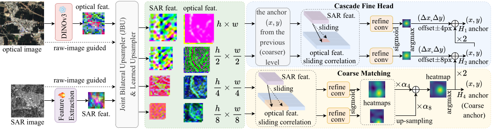
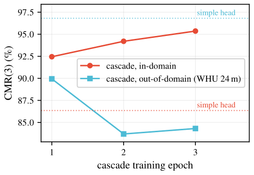
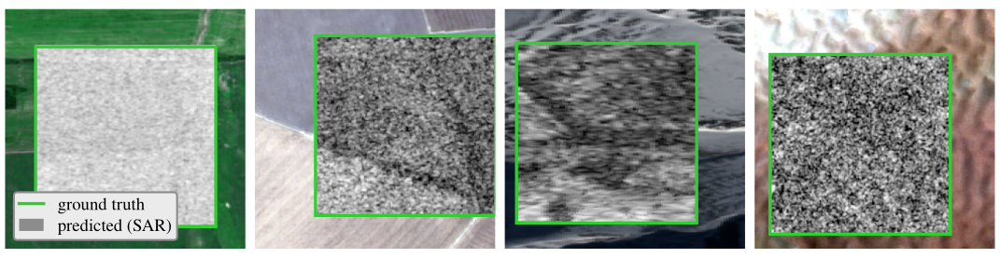

# Template-Matching-DINOv3 (DOSR-Net) · 中文文档


**DOSR-Net** 是面向遥感图像配准的 **SAR ↔ 光学跨模态模板匹配**框架（TGRS 2026）。
它把一小块 SAR 模板定位到较大的光学参考图块内：用**冻结的 DINOv3 ViT-L/16**
（卫星预训练）作为光学骨干，配一个**联合训练的 SAR CNN 编码器**，再用
**FeatUp / JBU** 图像引导上采样把两路特征图提分辨率，最后通过**由粗到细的级联**
归一化互相关完成匹配。整个模型族由 YAML 配置驱动，训练基于
[JackFramework](https://github.com/Archaic-Atom/JackFramework)（负责训练循环、DDP
启动、日志与 checkpoint 读写）。

<p align="center"></p>

> **论文（IEEE TGRS 2026）：** *Rethinking SAR–Optical Pre-Alignment with
> Foundation Models for Template Matching.* 匹配模块构造可用的跨模态分数，原始特征空间仍有差异。
> 在主预算和完整 SAR 编码器微调下，五 seed 的预对齐与随机初始化结果均值接近。
> 预对齐在冻结编码器及部分冻结、少量数据的一些设置下有收益。
> 直接训练级联在 SEN1-2 全测试集达到 CMR(1/3) 93.30/95.83。

模型族包含 `TM_Model_A..G`、`TM_Model_CB` 和 `TM_Model_CW`。
主方法为 `TM_Model_C`。其他变体用于检查初始化、编码器可训练性、光学 provider 和粗尺度上采样。

> 面向开发者的权威详解（入口链路、config-vs-CLI 优先级、dataloader 约定、级联头内部
> 结构、已知坑点清单）请见 **[`CODE_STRUCTURE.md`](CODE_STRUCTURE.md)**。本文档是
> 代码使用层面的概览，细节链接到该文档而不重复展开。

---

## 主要特性

- **256/192 几何。**光学参考图块 **256×256**，SAR 模板 **192×192**；真值标签
  `(x, y)` 是 SAR 模板在光学图块内的**左上角坐标**，因此位移范围为 `[0, 64]`。
  （由旧的 128/64 几何迁移而来，以匹配 ME-SSM 评测协议。）
- **冻结的 DINOv3 ViT-L/16 光学骨干**（`dinov3_vitl16`，卫星预训练 `sat493m` 权重，
  1024 维 stride-16 特征），搭配**联合训练的 `SarResNet16GN`** SAR 编码器
  （ResNet 风格，GroupNorm，无 BatchNorm）。
- **FeatUp / JBU 上采样。**图像引导的 `JBULearnedRange` 上采样器
  （`featup.upsamplers`）将 stride-16 特征提到 stride-4/8 供匹配使用；端到端训练
  （**不复用** FeatUp 的 DINOv2 预训练权重）。
- **由粗到细级联匹配。**归一化互相关（SAR 模板作为卷积核，光学搜索区作为输入）：
  先在 stride-4 + stride-8 做粗匹配，再围绕脱离梯度的粗匹配 argmax 做窗口化的
  stride-2、stride-1 细化。
- **JackFramework + WebDataset 训练。**面向约 1320 万样本训练集的可迭代
  WebDataset 分片管线，含自定义的 DDP 均衡分片切分、大样本 shuffle 缓冲，以及
  评测用的 map-style 后端。
- **`TM_Model_A..G`、`CB`、`CW` 消融族**，分别隔离 Stage-1 预对齐作为初始化、级联 vs 标准细化头、
  亚像素解码、以及一个 learned-inner-product（VICReg）探针。
- **跨数据集零样本评测**适配器：**WHU-OPT-SAR**（跨传感器）、**QXS-SAROPT**
  （跨分辨率），外加可控的 GSD 扫描工具。
- **分析 / 探针工具**（`Source/Tools/`、`Source/Tools/probes/`），产出论文分析部分的
  机理数字（相似性存在于何处、对照实验组、按读出定义的恢复曲线、CKA 与定位对照等）。

---

## 仓库结构

```
Template-Matching-DINOv3/
├── CODE_STRUCTURE.md              # 权威开发者文档（建议先读）
├── Source/
│   ├── main.py                    # 唯一入口（python Source/main.py ...）
│   ├── Libs/dinov3/               # DINOv3 git 子模块（冻结光学骨干）
│   ├── UserModelImplementation/
│   │   ├── user_interface.py      # CLI 接口 + dataset/model zoo 分发
│   │   ├── user_define.py         # ROOT_PATH / DINOv3 仓库 + 权重路径常量
│   │   ├── Models/
│   │   │   ├── __init__.py        # model_zoo：A..G、CB、CW → 接口类
│   │   │   ├── builder.py         # YAML → ComposedTM 组装
│   │   │   ├── _interface_base.py # 通用 JackFramework 模型 handler
│   │   │   ├── TM_Model_{A..G,CB,CW}/   # 各变体 config.yaml（+ 极薄 __init__.py）
│   │   │   ├── _components/        # 骨干、JBU、匹配头、损失、解码
│   │   │   └── _legacy/legacy_A/   # A 的原始手写实现（仅供参考）
│   │   └── Dataloaders/            # TMDataloader（map-style + WebDataset 双后端）
│   └── Tools/                      # 评测/指标/探针脚本（+ probes/）
├── Scripts/
│   ├── common.sh                   # 共用配置与助手（所有启动脚本 source 它）
│   ├── reproduce/                  # ① 用发布的模型直接测试（不训练）
│   ├── train/                      # ② 自己训练，然后测试
│   ├── legacy/                     # 原始的逐实验启动脚本（含服务器路径）
│   └── legacy_128_64/              # 已弃用的 128/64 几何脚本
├── Datasets/                       # CSV 清单示例；图像数据另行下载
├── Weights/                        # DINOv3 权重（已 gitignore，需单独下载）
├── assets/                         # README 配图（pipeline、定性结果等）
├── MODELS.md                       # 预训练模型清单（下载 + 放置）
├── README.md / README_zh.md
└── LICENSE
```

完整且最新的目录树见 **[`CODE_STRUCTURE.md` §1](CODE_STRUCTURE.md)**。

---

## 模型变体

各变体使用冻结的 DINOv3 光学特征、`SarResNet16GN` SAR 编码器和 256/192 几何。
`CB` 将粗尺度 JBU 换为双线性上采样，`CW` 更换光学 provider，`G` 用于共享初始化对照的可训练臂。
每个变体通过自己的 `config.yaml` 配置。

| 变体 | 匹配头 | Stage-1（`load_pretrained_sar`） | Stage-2 SAR（`freeze_sar_encoder`） | Stage-2 损失 | 解码 | 隔离的因素 |
|---|---|---|---|---|---|---|
| **A** | `StandardMatchingHeadJBU` | `true`（从 Stage-1 对齐权重热启动） | `false`（继续训练） | `two_stage_matching_loss` | hard argmax | Stage-1 预对齐**作为初始化**（与 B 唯一差别） |
| **B** | `StandardMatchingHeadJBU` | `false`（随机 SAR 初始化） | `false` | `two_stage_matching_loss` | hard argmax | 无 Stage-1 的对照 / A 的基线 |
| **C** | `CascadeHeadJBU` | `false`（直接训练，无 Stage-1） | `false`（联合） | `cascade_loss` | hard argmax | **提出的方法**——直接训练的级联 |
| **D** | `StandardMatchingHeadJBU` | `true` | `true`（冻结） | `two_stage_matching_loss` | `soft_subpixel` | A 头上加亚像素解码（复用 A 权重，仅评测） |
| **E** | `CascadeHeadJBU` | `true` * | `true` * | `cascade_loss` | `soft_subpixel` | 级联 + 亚像素；**在 C 的权重上评测** |
| **F** | `StandardMatchingHeadJBU`（Stage-1 加 `AlignmentIPHead`） | `true` | `true`（冻结） | `two_stage_matching_loss` | hard argmax | learned-inner-product Stage-1（W_s/W_d + VICReg 秩下限）+ 冻结编码器 Stage-2 |
| **G** | `StandardMatchingHeadJBU` | 共享 Stage-1 或随机初始化 | `false` | `two_stage_matching_loss` | hard argmax | 共享初始化四臂实验的可训练行 |
| **CB** | `CascadeHeadBilinear` | `false` | `false` | `cascade_loss` | hard argmax | 只将粗尺度 stride-16-to-4/8 JBU 换为双线性 |
| **CW** | `CascadeHeadJBU` | `false` | `false` | `cascade_loss` | hard argmax | 使用 web 预训练的 LVD-1689M provider |

**权重复用：**D 复用 A 的权重、E 复用 C 的权重——两者只在评测期改动 `argmax_type`
（亚像素），并保持 `matching.args` 逐字节一致以便 state_dict 对齐。注意只有
`matching.args` 逐字节一致、而非整份 config：与 E 类似，D 自己的训练段也不同于它借用的
模型（D 设 `freeze_sar_encoder: true`，而 A 为 `false`），所以 D 的设计意图是**在 A 的
权重上评测**，而非按它自己的 config 训练。亚像素在代码里存在
（`_components/sub_pixel.py`），但**不是**论文的核心贡献。

> \* **TODO / 注意：**E 的架构与 state_dict 与 C 逐字节兼容，设计意图是**在 C 的权重上**
> 用亚像素解码评测。但 E 自己 `config.yaml` 的训练段（`load_pretrained_sar: true`、
> `freeze_sar_encoder: true`、非零 warmup）相对 C 转向直接训练后已**过时**，按原样启动
> 并不能复现 C。请把 E 理解为“C 的架构 + 亚像素解码、在 C 权重上评测”；若要按 E 自己的
> 配置训练，请先与作者确认意图。

修订后的四臂实验由 F 实现冻结臂，G 实现可训练臂。
两个预对齐臂使用同一 Stage-1 checkpoint。C/CB 对照保留两侧细尺度可学习上采样和 raw stem。
原 A/B/F 单次结果单独保留。

---

## 实验结果

所有数字均遵循 **ME-SSM 评测协议**（SEN1-2，光学参考 256×256、SAR 模板 192×192）：
逐模板 **CMR@k px**（像素阈值下的正确匹配率——每个模板一个 `(x, y)`，稠密零拒绝）。
采用相同几何和 CMR 指标，SEN1-2 按同一协议独立抽样。主表比较完整系统，
四臂实验则固定匹配架构和训练数据。

### 域内 SOTA（SEN1-2 全测试集）

提出的直接训练级联（`TM_Model_C`）在**两个**阈值上都超越已有方法。全测试集 = 全部
7,740 对 × 289 偏移（≈224 万位置）。

| 方法 | 出处 | CMR(1) ↑ | CMR(3) ↑ | CMR(5) ↑ |
|---|---|---|---|---|
| ME-SSM（协议来源） | TGRS 2026 | 62.14 | 89.19 | 93.04 |
| VU-Net | ICSIDP 2024 | 63.0 | 87.0 | 90.0 |
| RMSO-ConvNeXt | — | — | 94.36 | — |
| **本文（级联 C，直接训练）** | — | **93.30** | **95.83** | **96.30** |

平均误差 1.13 px，中位数 0 px。`Checkpoint_C_phase2_8gpu/model_epoch_2.pth`。

### 共享初始化比较（表 V，20k）

下表为五轮匹配训练后、seeds 2024–2028 的均值 ± 样本标准差。
两个 S1 臂均从同一份对称 learned-inner-product Stage-1 权重开始。

| Arm | CMR(1) ↑ | CMR(3) ↑ | MEE (px) ↓ |
|---|---|---|---|
| S1/Tr | 67.86 ± 0.75 | 86.15 ± 0.21 | 3.672 ± 0.052 |
| R/Tr | 67.84 ± 0.91 | 86.14 ± 0.21 | 3.608 ± 0.058 |
| S1/Fr | 67.48 ± 0.26 | 86.16 ± 0.22 | 3.666 ± 0.035 |
| R/Fr | 67.49 ± 1.22 | 85.04 ± 0.29 | 4.069 ± 0.061 |

在主预算下，完整微调的两个臂准确率均值接近。
冻结编码器时，预对齐提高 3px 准确率并降低平均误差。
部分冻结及 500/1000 对源图像的补充实验也有收益。
原单次结果单独列在 [MODELS.md](MODELS.md)。

### 表征诊断

探针检查原始余弦定位、配对内容依赖、表示变化和子空间限制后的恢复。
恢复曲线按固定读出解释，不再使用严格的容量差推断。
初始化对照直接检验额外预对齐阶段对最终匹配效果的作用。
代码见 [`Source/Tools/probes/`](Source/Tools/probes/) 和 `probe_common_level.py`。

### 跨数据集零样本（级联，无需重训）

专门化的级联在其高置信半区迁移很强、但在粗尾部退化；OOD 鲁棒性随训练专门化程度*下降*
（见 [`CODE_STRUCTURE.md`](CODE_STRUCTURE.md) 与论文 Discussion）。

| 数据集 | 迁移类型 | CMR(3) | 高置信 CMR(3) | 大误差失败 % |
|---|---|---|---|---|
| WHU-OPT-SAR | 跨传感器（10 m） | 74.39 | 96.12 | 4.64 |
| QXS-SAROPT | 传感器与分辨率变化（1 m） | 10.40 | 10.80 | 31.35 |

<p align="center"></p>

### 定性结果（SEN1-2 域内）

SAR 模板（灰）贴在**预测**位置；绿框 = 真值。

<p align="center"></p>

---

## 预训练模型

下载地址保持不变。`Weights` 文件夹保留原 11 个权重文件，
并在 `Revision_20261107/` 中增加 66 个返修 checkpoint。
放置方式见 [MODELS.md](MODELS.md)；当前论文表格、图片、seed、epoch 的对应关系见
[MODELS_REVISION.md](MODELS_REVISION.md) 和[逐文件索引](docs/checkpoints_revision.csv)。

> **下载（百度网盘）：**
> <https://pan.baidu.com/s/1lhXTqkXKwzg5H9PVtt01EQ?pwd=ug7r> ——提取码：`ug7r`

分享的 `Weights` 文件夹里就是全部内容：

| 文件 / 目录 | 大小 | 内容 |
|---|---|---|
| `dinov3_vitl16_pretrain_sat493m-eadcf0ff.pth` | 1.2 GB | 冻结的 DINOv3 ViT-L/16 光学骨干（公开 Meta 权重） |
| `Checkpoint_C_phase2_8gpu/` | 237 MB | **提出的级联 `TM_Model_C`**（headline） |
| `Checkpoint_A_ft_256/`、`Checkpoint_B_256/` | 各 178 MB | S1/Tr（A-ft）、R/Tr（B）可训臂 |
| `Checkpoint_F_s2_frozen_256/`、`Checkpoint_RF_s2_frozen_256/` | 各 102 MB | S1/Fr、R/Fr 冻结臂 |
| `Checkpoint_A_stage1_256/`、`Checkpoint_F_stage1_256/` | 76 / 80 MB | Stage-1 对齐（A）与 learned-IP（F）编码器 |
| `Revision_20261107/` | 66 个 checkpoint 文件 | 共享初始化、早期轮次、预算、部分冻结、少数据与上采样对照 |

**放置：**骨干放到 `Weights/dinov3_vitl16_pretrain_sat493m-eadcf0ff.pth`（每个 `config.yaml`
都按 `${root_path}/Weights/...` 解析这个路径）；各 `Checkpoint_*/` 目录放到**项目根目录**、
与 `Source/` 同级：

```bash
bash Scripts/reproduce/eval_cascade.sh Checkpoint_C_phase2_8gpu/model_epoch_2.pth 0
```

### 哪个权重配哪个脚本

`按名字` = 脚本用写死的目录名去打开它，**必须**以该名字放在项目根目录；
`按参数` = checkpoint 路径由你传入，放哪都行。

| 权重（放项目根目录） | 由谁训练 | 由谁评测 | 查找方式 |
|---|---|---|---|
| `Checkpoint_C_phase2_8gpu/model_epoch_2.pth`<br>**提出的级联** | `run_train_C_direct.sh sub40` → `full_resume`（写出 `Checkpoint_C_direct_{sub40,full}_256/`） | `run_eval_C_2k.sh <ckpt> <tag> [gpu]`<br>亚像素变体：`run_eval_E_2k.sh <ckpt> <tag> [gpu]` | **按参数** |
| `Checkpoint_A_ft_256/model_epoch_4.pth`<br>S1/Tr（A-ft） | `run_a_ft_vs_b.sh`（写到此目录） | `run_eval_std_2k.sh TM_Model_A <ckpt> <tag>` | 按名字（训练时） |
| `Checkpoint_B_256/model_epoch_4.pth`<br>R/Tr（B） | `run_a_ft_vs_b.sh`（写到此目录） | `run_eval_std_2k.sh TM_Model_B <ckpt> <tag>`<br>另外 `run_eval_frozen_full.sh` 会**按名字固定读 epoch 4** | **按名字** |
| `Checkpoint_F_s2_frozen_256/model_epoch_4.pth`<br>S1/Fr | `run_frozen_arms_F.sh` | `run_eval_frozen_full.sh [FEPOCH] [CSV] [N] [TAG]`——**按名字**读 | **按名字** |
| `Checkpoint_RF_s2_frozen_256/model_epoch_4.pth`<br>R/Fr | `run_frozen_arms_F.sh` | `run_eval_frozen_full.sh [FEPOCH] [CSV] [N] [TAG]`——**按名字**读 | **按名字** |
| `Checkpoint_A_stage1_256/model_epoch_5.pth`<br>Stage-1 对齐 | `start_train_stage1_256_A.sh` | 作为 Stage-1 热启动被 `run_a_ft_vs_b.sh`（`S1=` 行）取用 | **按名字** |
| `Checkpoint_F_stage1_256/model_epoch_9.pth`<br>Stage-1 learned-IP | `start_train_stage1_256_F.sh` | 作为 Stage-1 热启动被 `run_frozen_arms_F.sh`（`S1=` 行）取用 | **按名字** |
| `Weights/dinov3_vitl16_pretrain_sat493m-eadcf0ff.pth`<br>冻结骨干 | ——（公开 Meta 权重） | 所有变体，经各 `config.yaml` 的 `${root_path}/Weights/...` | **按名字** |

通用 `tm_eval` 接受各模型的 checkpoint 路径。旧版脚本和四臂启动脚本使用表中目录名；
使用这些入口时保留原名，或通过通用 helper 显式传入权重路径。

> **脚本按原样并不可移植**——运行任何脚本前请先看[需要修改的路径](#需要修改的路径)。

---

## 快速开始

`Scripts/` 下有两个入口，都会 source `Scripts/common.sh`——它由自身位置推导项目根目录、
所有数据路径走环境变量，因此仓库放在任何路径都无需改脚本。

### ① 用发布的模型直接测试 —— [`Scripts/reproduce/`](Scripts/reproduce/)

只做推理；不训练，也不会改动任何已发布的权重。

```bash
export TM_EVAL_CSV=/path/to/image_test_2k_256.csv

bash Scripts/reproduce/eval_cascade.sh                  # 表 I  —— 本文级联
bash Scripts/reproduce/eval_arms.sh 0                   # 表 IV —— 原单次比较
bash Scripts/reproduce/eval_cross_dataset.sh            # 表 VIII —— 零样本跨数据集
```

在 RTX 4080 上用发布的 cascade、2k 评测集实测：
`PCK@1 93.20 / PCK@3 95.70 / PCK@5 96.05`，平均 1.10 px——与论文中该权重的 2k 结果一致。

### ② 自己训练 —— [`Scripts/train/`](Scripts/train/)

```bash
export TM_TRAIN_LIST=./Datasets/shard_train_256_full.csv

bash Scripts/train/train_cascade.sh smoke               # 单卡，能看到真实 traceback，先跑这个
bash Scripts/train/train_cascade.sh phase1 4 10         # 子集热启动
bash Scripts/train/train_cascade.sh phase2 Checkpoint_C_direct_sub40_256/model_epoch_4.pth
```

预对齐消融（`train_stage1.sh`、`train_arms.sh`）只在复现 2x2 因果实验时才需要——
本文方法完全不用 Stage-1。

> 原始的逐实验启动脚本已移至 [`Scripts/legacy/`](Scripts/legacy/)，其中写死了我们服务器的
> 路径，仅作可追溯保留。

---

## 安装

> **本仓库不含 `requirements.txt` / `environment.yml` / `setup.py`。**下列依赖是从
> import 和启动脚本（均指向训练服务器上名为 **`stereoA`** 的 conda 环境）反推得到的，
> 版本未在此固定——请装入较新的 PyTorch 2.x 环境。

```bash
# 1. 连同 DINOv3 子模块一起克隆（冻结光学骨干）。
git clone --recurse-submodules https://github.com/Archaic-Atom/Template-Matching-DINOv3.git
cd Template-Matching-DINOv3
# 没有 SSH 密钥？子模块 URL 是 git@github.com:facebookresearch/dinov3.git，
# 可改写为 https://github.com/facebookresearch/dinov3.git。

# 2. 安装 JackFramework（未内置于本仓库；负责训练循环 / DDP / I/O）。
git clone https://github.com/Archaic-Atom/JackFramework.git
cd JackFramework && ./install.sh && cd ..

# 3. 安装 FeatUp（必需——外部依赖，不是子模块）。
#    JBU 上采样器（当前所有变体都用）会 import
#    `featup.upsamplers.JBULearnedRange`。从 facebookresearch/FeatUp 安装。

# 4. 其它 Python 依赖（装入同一环境）：
#    torch, torchvision, numpy, pandas, pyarrow, Pillow, webdataset
#    （可迭代训练需要 webdataset；CSV 评测读取需要 pyarrow）。

# 5. 把 DINOv3 卫星预训练权重放到 Weights/（已 gitignore）：
#    Weights/dinov3_vitl16_pretrain_sat493m-eadcf0ff.pth   （DINOv3 ViT-L/16，约 1.2 GB）
#    下载见上文“预训练模型”一节（百度网盘分享，提取码 ug7r）。
```

### 需要修改的路径

下列路径全部写死指向**我们的训练服务器**，没有任何自动探测。运行任何东西之前请先过一遍这份清单。

**1. Python 侧常量**——`Source/UserModelImplementation/user_define.py`：

| 常量 | 发布时的值 | 要改吗 |
|---|---|---|
| `ROOT_PATH` | `/data/raozhibo/Documents/Programs/Template-Matching-DINOv3/` | **要** ——改成你自己的克隆路径，或启动时传 `--root_path`。它会被替换进各 `config.yaml` 的 `${root_path}` 占位符。 |
| `WEIGHTS_PATH` | `Weights/dinov3_vitl16_pretrain_sat493m-eadcf0ff.pth` | 不用——相对于 `ROOT_PATH`，骨干放这即可。 |
| `DINOv3_PATH` | `Source/Libs/dinov3/` | 不用——相对路径，git 子模块。 |
| `DINOv2_PATH`、`WEIGHTS_DINOV2_PATH` | `Source/Libs/dinov2/`、`Weights/depth_anything/model.pth` | 遗留未使用，忽略。 |

**2. 启动脚本头部变量**——`Scripts/` 下各脚本的开头几行：

| 变量 | 发布时的值 | 涉及脚本数 |
|---|---|---|
| `PROJ` | `/data/raozhibo/Documents/Programs/Template-Matching-DINOv3`（多数脚本还会 `cd "$PROJ"`） | 41 个里 29 个 |
| `PY` | `/data/raozhibo/anaconda3/envs/stereoA/bin/python` | 41 个里 28 个 |

**3. 脚本内的数据集/清单路径**——这些数据**不在**仓库里（重新生成见[数据准备](#数据准备)）：

| 变量 | 发布时的值 | 用途 |
|---|---|---|
| `MANIFEST`、`CSV`、`EVAL_CSV` | `/data4/datasets/eval2k_opt256_sar192/image_test_2k_256.csv` | 域内 2k 评测（另有 `eval10k_…`、`eval20k_…` 变体） |
| `CSV`、`EVAL_CSV`（相对写法） | `Datasets/test_256_2k.csv` | 同一评测集的仓库相对路径写法 |
| `CSV` | `/data5/datasets/cross_eval/whu_opt_sar/cross_eval.csv`<br>`/data5/datasets/cross_eval/qxs_saropt/cross_eval.csv` | 跨数据集零样本评测 |
| `RAW` | `/data5/datasets/whu-opt-sar`、`/data5/datasets/QXSLAB_SAROPT` | 适配器用的原始数据集 |
| `OUTBASE` | `/data5/datasets/cross_eval_resolution` | GSD 扫描输出 |
| `--trainListPath` | `./Datasets/shard_train_256_full.csv`、`/data5/datasets/TM_shards/shard-…` | WebDataset 训练分片 |

> `/data4` 与 `/data5` 并存是数据在机器间迁移留下的痕迹——重定向时**两个都要 grep**。

快速查看某个脚本会用到的全部绝对路径：

```bash
grep -nE "^(PROJ|PY|MANIFEST|CSV|EVAL_CSV|RAW|OUTBASE)=|/data[0-9]*/" Scripts/<script>.sh
```

**DDP 注意：**由于光学骨干（部分变体下还有 SAR 编码器）被冻结，JackFramework 的 DDP
封装需要 `find_unused_parameters=True`。该补丁只存在于训练服务器上的 JackFramework
安装中——见 [`CODE_STRUCTURE.md §2.5`](CODE_STRUCTURE.md)。

---

## 数据准备

### 域内 SEN1-2（256/192）WebDataset 分片

生产用造数据脚本是 **`Scripts/make_opt256_sar192_shards.py`**（`Source/Tools/` 下有一份
逐字节相同的副本）。它把共配准的 256×256 SEN1-2（Sentinel-1 SAR `s1_*` + Sentinel-2
光学 `s2_*`，四季）直接裁剪打包成 WebDataset `.tar` 分片——无中间 PNG：

- **光学参考** = 原始 256×256 的 `s2` PNG 字节，逐字节复制。
- **SAR 模板** = `s1` 在左上角 `(cx, ry)` 裁剪到 192×192 后重新编码为 PNG。
- 每个样本 = 共享同一 key 的三个 tar 条目：
  `<key>.sar.png`（192×192 灰度）、`<key>.rgb.png`（256×256 RGB）、
  `<key>.label.cls`（ASCII `"<cx> <ry>"`——左上角，**非**中心，**未**归一化）。

训练/测试在**场景/图块级别互不相交**（按季固定种子切分，无场景泄漏）。偏移用于样本扩增：
**TEST** 用密集的 stride-4 网格（每对 `17×17 = 289` 个偏移）；**TRAIN** 用随机偏移
（默认每对 48 个）。

```bash
# 先造 test（快），再造 train（适合 nohup 的封装脚本）：
bash Scripts/legacy/run_gen_opt256_sar192.sh
# 或直接：
python Scripts/make_opt256_sar192_shards.py --split test  --workers 16
python Scripts/make_opt256_sar192_shards.py --split train --workers 16
```

输出 `TM_shards_opt256_sar192_{train,test}/`，并附一个**分片清单 CSV**
`shard_path.csv`（表头 `path,file_num`）——可迭代后端据此得知每个分片的样本数，并以
`sum(file_num)` 作为权威的磁盘样本总数。默认设置下，测试集约 224 万样本
（7740 对 × 289），完整训练集约 1318 万样本；训练集精确数量取决于 SEN1-2 目录树。

一个小的 **map-style** 评测 CSV（`SAR_Image,RGB_Image,Label`，`Label = "[cx, ry]"`
JSON）由 **`Scripts/make_2k_eval_256.py`** 从同一互不相交的 `test_pairs.txt` 生成，
默认 2000 个样本。

### 跨数据集零样本适配器

**`Source/Tools/cross_dataset_adapter.py`** 把外部 SAR-光学数据集重采样到目标 GSD，
并产出 SEN1-2 形状的 256/192 评测对（`SAR_SIZE=192`、`RGB_SIZE=256`；注意模块/类
docstring 仍写“64/128”——那是过时文字，以代码为准）：

| 适配器（`--dataset`） | 来源 | 原生 → 目标 GSD | 角色 |
|---|---|---|---|
| `whu_opt_sar` | WHU-OPT-SAR（GF-1 + GF-3） | 5 m → 10 m（下采样） | 跨传感器 |
| `qxs_saropt`  | QXS-SAROPT（GF-3 + Google Earth，原生 256×256） | 1 m → 1 m（不重采样） | 跨分辨率 |
| `sarptical`   | SARptical（TerraSAR-X + 航拍） | 1 m → 10 m | 跨传感器（辅助） |

```bash
bash Scripts/legacy/run_regen_cross_256.sh     # 在 256/192 下重造 WHU + QXS
```

每次运行写出 `sar/`、`rgb/`、一个 `manifest.pt`（供 `Scripts/pack_to_webdataset.py` 使用）、
一个 `cross_eval.csv`（`SAR_Image,RGB_Image,Label`，与域内 map-style 评测 CSV 同 schema，
可直接被 `--mode test` 消费），以及一个 `meta.json` 溯源文件。`--target_res_m`
（仅下采样、有保护）驱动可控 GSD 扫描（`Scripts/legacy/run_whu_res_sweep.sh`）。

### 清单 CSV 格式（切勿混淆）

| | 分片清单 CSV（可迭代后端） | 路径清单 CSV（map-style 后端） |
|---|---|---|
| 表头 | `path,file_num` | `SAR_Image,RGB_Image,Label` |
| 每行 = | 一个 `.tar` 分片 | 一个样本 |
| `Label` | — | JSON `[x, y]` 字符串 |

> `Datasets/` 下唯一被 git 跟踪的文件是 `dataset_example_training_list.csv`，它是一个
> **过时的立体视差示例**（`left_img,right_img,gt_disp`）——**不是** TM 清单。真实清单
> （`shard_train_256_full.csv`、子集热启动清单、各评测 CSV）**并未提交**，只存在于
> 训练服务器上。注意它们**并不**被 `.gitignore` 覆盖（只有 `Datasets/image_*.csv|.pt`
> 与 `Datasets/*.txt` 被覆盖），所以小心不要误提交某个分片/评测清单。

---

## 训练

**没有单独的 `train.py`**——一切都通过 `python Source/main.py <flags>` 运行，由
`--mode train|test` 选择行为。CLI 有两类 flag：少量**项目 flag**（如 `--is_stage_2`、
`--sar_size`、`--root_path`、`--shuffle_buffer`）和 **JackFramework 内置 flag**
（`--mode --modelName --dataset --dist --gpu --batchSize --port --lr --maxEpochs
--imgNum --trainListPath --modelDir ...`）。

> **重要的优先级规则：**在 YAML 路径下，大多数架构/损失 CLI flag
> （`--matching_dim`、`--fine_dim`、`--fine_margin`、`--match_w*`、`--fine_warmup_epochs`）
> **是失效的**——头维度与损失权重来自各变体的 `config.yaml`。脚本仍传它们只是“为了对齐
> 写法”。**真正生效**的包括 `--is_stage_2`、`--lr`、`--maxEpochs`、`--root_path`、
> `--sar_size`（dataloader 侧）。见 [`CODE_STRUCTURE.md §2.3 / §11`](CODE_STRUCTURE.md)。
>
> **`sar_size` 双通道坑：**匹配头从 `config.yaml` 读 `architecture.matching.sar_size`
> （写死的 `192`，CLI 无法替换），dataloader 从 CLI 读 `--sar_size`。**两者必须一致。**
> 始终传 `--sar_size 192` 并保持 config 为 `192`。
>
> **`--imgNum` 只是进度条分母**，不是真实 epoch 长度（WebDataset 路径用
> `with_epoch(per_worker_samples)`，由清单的 `real_total` 推出）。脚本里固化的约定是
> `--imgNum == sum(file_num)`，启动脚本用 `awk` 对清单求和得到。

### 提出的方法（`TM_Model_C`）——两阶段流程

`TM_Model_C` 直接训练（随机 SAR 初始化、无 Stage-1、SAR 编码器与级联联合训练）。科学
运行分**两阶段**，均通过 `Scripts/legacy/run_train_C_direct.sh`：

```bash
# 阶段一 —— 子集热启动（subset40 清单 ~1.34M，4 卡 DDP，bs10，5 epoch）。
bash Scripts/legacy/run_train_C_direct.sh sub40

# 阶段二 —— 全量 ×3 epoch，从阶段一 checkpoint 热启动。
# 内部：strip_stage1_opt.py 丢掉优化器状态并把 epoch 重置为 -1，使 JF 从干净的
# epoch 0 开始，再用手写的 checkpoint.list 固定它。
bash Scripts/legacy/run_train_C_direct.sh full_resume Checkpoint_C_direct_sub40_256/model_epoch_4.pth
```

`Scripts/legacy/chain_to_phase2.sh` 自动衔接（轮询直到阶段一退出，确认 `model_epoch_4.pth`
存在，等 GPU 释放后在 `nohup` 下启动阶段二，可扛 SSH 断连）。另一个一次性脚本
`Scripts/legacy/run_train_C_direct_full.sh` 跳过子集阶段（模式 `smoke` / `mem N` / `full N`）。

> 注意：`run_train_C_direct.sh full_resume` 跑 **3** 个 epoch，而
> `run_train_C_direct_full.sh full` 跑 **5** 个，两者都写到
> `Checkpoint_C_direct_full_256/`。它们是通往全量训练的两条不同路线，不可互换——请
> 明确选择其一。

**务必先做单卡 smoke 测试**（`--dist False` 才能看到真实 traceback）：

```bash
bash Scripts/legacy/run_train_C_direct.sh smoke
```

`run_train_C_direct.sh` 实际发出的命令（请替换为你自己的 python / 项目根 / 路径）：

```bash
CUDA_VISIBLE_DEVICES=0,1,2,3 python -u Source/main.py \
  --mode train --dataset tmdataset --modelName TM_Model_C --is_stage_2 True \
  --dataloaderType iterable --dataloaderNum 8 --sampleNum 1 \
  --sar_size 192 --matching_dim 256 --shuffle_buffer 100000 --lr 1e-3 \
  --auto_save_num 1 --dist True --gpu 4 --batchSize 10 --port 8867 \
  --trainListPath ./Datasets/shard_train_256_full.csv \
  --imgNum <清单 file_num 之和，约 13.18M> --maxEpochs 3 \
  --log ./log_c_full/ --outputDir ./result_c_full/ \
  --resultImgDir ./ResultImg_c_full/ --modelDir ./Checkpoint_C_direct_full_256/
```

> `--dataloaderType` 是 **JackFramework 核心 flag，默认 `mapstyle`**——要用 WebDataset
> 分片管线，必须显式传 `--dataloaderType iterable`。

### 其它变体 / 消融（256/192 脚本）

- `Scripts/legacy/run_a_ft_vs_b.sh` —— 干净的“Stage-1 初始化是否有帮助”消融：A-ft（热启动、
  SAR 可训）vs B（随机 SAR），唯一差别是 SAR 初始化。
- `Scripts/legacy/start_train_stage1_256_A.sh` / `start_train_stage1_256_F.sh` —— Stage-1
  对比式预对齐（A）与 learned-inner-product/VICReg 预对齐（F）。
- `Scripts/legacy/run_frozen_arms_F.sh` / `run_frozen_arms_F_seed.sh` —— 冻结编码器的
  双臂实验（及其多种子复现）。

> `Scripts/start_train_stage2_{A..E}_wds.sh` 以及 `Scripts/legacy_128_64/` 里的一切
> 都是**遗留的 128/64 几何**脚本，已被上面的 256/192 脚本取代。遗留的 Stage-2 脚本仍是
> 仓库内对原始 A–E 消融语义最清晰的说明，但不应再用于当前几何下的训练。

### Checkpoint

只保存 `model.trainable_tail.state_dict()`（SAR 编码器 + 匹配头 + fusion；冻结的 DINO
骨干不重复保存），每 `--auto_save_num` 个 epoch 存一次到 `--modelDir`。JackFramework
通过该目录下的纯文本 `checkpoint.list`（两行：`last model name:<file>` 再 `<file>`）选择
加载哪个 checkpoint。续训只需把 `--modelDir` 指向其 `checkpoint.list` 指明目标文件的目录；
所有加载均为 `strict=False`。从既有 checkpoint **全新热启动**时用
`Source/Tools/strip_stage1_opt.py` 丢掉优化器状态并重置 epoch 计数。

---

## 评测

评测以 `--mode test` 跑在 **map-style** 后端上（评测脚本故意**不**传
`--dataloaderType iterable`），针对 map-style CSV（`SAR_Image,RGB_Image,Label`）。每个评测
脚本把单个 checkpoint 固定进一个干净目录、写一个两行 `checkpoint.list`，并以 batch 1、
`TM_SEED=2024` + `CUBLAS_WORKSPACE_CONFIG=:4096:8` 确定性运行。

```bash
# 域内 2k（提出的级联，hard argmax）：
bash Scripts/legacy/run_eval_C_2k.sh <src_ckpt.pth> <tag> [gpu]

# 级联 + 亚像素（E），在 C 的 checkpoint 上评测：
bash Scripts/legacy/run_eval_E_2k.sh <C_ckpt.pth> <tag> [gpu]

# 标准头变体 A / B / D：
bash Scripts/legacy/run_eval_std_2k.sh <TM_Model_A|B|D> <src_ckpt.pth> <tag> [gpu] [port]

# 更大的域内评测集（10k / 20k）与 frozen-arms 全流程：
bash Scripts/legacy/run_eval_B_256_10k.sh
bash Scripts/legacy/run_eval_A_256_10k.sh
bash Scripts/legacy/run_eval_frozen_full.sh [FEPOCH] [EVAL_CSV] [EVAL_N] [TAG]

# 跨数据集零样本（WHU 跨传感器，QXS 跨分辨率）：
bash Scripts/legacy/run_eval_whu_matched.sh [CSV] [N] [TAG]
bash Scripts/legacy/run_whu_res_sweep.sh      # 可控 GSD 扫描（PCK vs GSD）
```

`--mode test` 写出按 rank 的临时 CSV，由 rank-0 合并为
`test_<dataset>_<timestamp>.csv`（列
`index,sar_name,rgb_name,gt_x,gt_y,pred_x,pred_y,score`）。用以下脚本转成指标：

```bash
python Source/Tools/pck_summary.py <merged_test.csv>     # PCK/CMR@{1,2,3,5,10}px + 分组
python Source/Tools/eval_test_csv.py --csv <merged_test.csv>   # L2 统计 + PCK@1..5（支持 --n/--seed）
```

报告指标是**逐模板 PCK / CMR**（在某像素阈值下的正确匹配率——每个模板一个 `(x, y)`）。
成对模型比较用 `Source/Tools/paired_bootstrap_pck.py`，给出点估计、95% 置信区间与
`P(A 优于 B)`。

---

## 分析与探针工具

`Source/Tools/` 存放分析与指标脚本；`Source/Tools/probes/` 存放产出论文分析部分数字的
机理探针（默认样本 `Checkpoint_B_256/model_epoch_4.pth`）。探针分三组——完整表格见
[`Source/Tools/probes/README.md`](Source/Tools/probes/README.md)。核心的*构造相似性*组：

- `probe_b_similarity.py` —— B 学到的跨模态相似性**存在于何处**（原始 stride-16 余弦 vs
  投影后的 stride-4 匹配子空间；含符号检查）。
- `probe_b_controls.py` —— 定位是**真实**的跨模态相似性还是内容无关的捷径？
  （对照实验组，含外来模板替换）。
- `probe_b_content.py` —— 为什么原始 DINO/SAR 特征正交却可投影？
  （CCA 共享子空间 + 边缘结构相关性）。
- `probe_b_keystone.py` —— 匹配是否真的**用到**了共享子空间，且该子空间是真实的还是
  空间自相关泄漏（去泄漏 CCA）？
- `probe_b_stage1sim.py` —— **learned inner product** 是否优于原始余弦作为 Stage-1 指标？
- `probe_b_collapse.py` —— learned-IP Stage-1 是否塌缩，可学习的 `W_d` 是否安全？
  （有效秩容量探针）。
- `probe_f0_mechanism.py` —— Stage-2 微调是否会**抹掉** Stage-1 的对齐？
  （“F0”机理：S1 vs A-ft vs B 编码器对齐 + 跨编码器 CKA）。

另有两组（自分析阶段归位）：**粒度—维度**恢复扫描（`probe_b_granularity_dim.py`、
`probe_c_granularity_dim.py`、`probe_b_matchdim{,_ood}.py`、`probe_b_conditional_dims.py`、
`probe_recovery_by_stride.py`、`probe_alignment_recovery.py`——匹配需要 ≳64 个分布式维度）与
**有效秩 / 覆盖**探针（`probe_erank_extractors.py`、`probe_erank_cascade.py`、
`probe_erank_granularity.py`——对齐 23 → 微调 12）。

辅助工具：`oracle_geom_ceiling.py`（理论匹配上界）、
`stage1_separation_2k.py` / `analyze_stage1_separation.py`（Stage-1 可分性、d′）、
`coarse_eval_ab.py`（Stage-1 是否对粗匹配层有帮助）、`ckpt_inspect.py`（dim128 vs dim256
/ 是否含 JBU）、`compare_dataset_stats.py`（域间差异统计）、
`parse_erank_logs.py` / `plot_frozen_arms.py`（论文配图数据准备）、
`stage_ablation.py`（级联阶段消融）、`ci_reject.py`（风险—覆盖/拒绝曲线）、
`profile_cascade.py`（运行时/效率剖析）。

---

## 引用

如果使用本代码，请引用论文（TGRS 2026）：

```bibtex
@article{rao2026rethinking,
  title   = {Rethinking {SAR}--Optical Pre-Alignment with Foundation Models
             for Template Matching},
  author  = {Rao, Zhibo and He, Mingyi and Li, Xing and Dai, Yuchao and
             Zhang, Congxuan and Shen, Zhelun and Ding, Biyun},
  journal = {IEEE Transactions on Geoscience and Remote Sensing},
  year    = {2026},
  note    = {To appear}
}
```

---

## 致谢

- **DINOv3**（Meta AI / FAIR）—— 冻结光学骨干，以 git 子模块形式置于
  `Source/Libs/dinov3/`，按其自身许可证再分发。
  <https://github.com/facebookresearch/dinov3>
- **FeatUp** —— JBU 图像引导上采样器（`featup.upsamplers.JBULearnedRange`）。
  <https://github.com/facebookresearch/FeatUp>
- **JackFramework** —— 训练框架（训练循环、DDP、日志、checkpoint）。
  <https://github.com/Archaic-Atom/JackFramework>

---

## 许可证

MIT，见 [`LICENSE`](LICENSE)。DINOv3 按其自身许可证再分发，详见上游仓库。

> **TODO：**`LICENSE` 文件当前写的是 `Copyright (c) 2018 BeautyOfWeb`，看起来是继承自
> 模板的残留，而非本项目作者——版权行可能需要修正。

## CPU 检查

以下检查不需要 CUDA 或下载权重。它们覆盖双线性投影、级联输出、相关运算布局、
变体配置差异及队列隔离，不启动训练。依赖见 `tests/requirements-cpu.txt`。

```bash
python -m unittest discover -s tests -v
python Scripts/autodl/test_review_overlap_20261027.py
```
